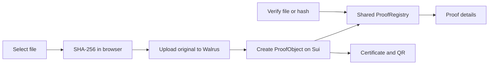

# Proof of Existence

A Sui dApp for registering a SHA-256 file hash as an immutable proof of existence. The original file is uploaded to Walrus; its hash, Walrus blob ID, owner, timestamp, and metadata are recorded by a Sui Move package. A file is never sent to the Sui contract.

## Architecture



The frontend is built with Next.js 15, React, `@mysten/sui`, `@mysten/dapp-kit`, and `qrcode.react`. The contract uses Sui Move 2024. Walrus testnet is used for file storage by default.

## Prerequisites

- Node.js 18.18 or newer (Node.js 20 LTS recommended) and npm
- A browser with a Sui-compatible wallet extension
- Sui CLI 1.68.1 or a compatible version for contract build, tests, and deployment
- Testnet SUI for publishing or creating proofs

## Quick Start

1. Clone the repository and install the frontend dependencies:

	```bash
	git clone https://github.com/ngthdanh05/proof_of_existence.git
	cd proof_of_existence/frontend
	npm install
	```

2. (Optional) Create `frontend/.env.local` to override the public defaults:

	```dotenv
	NEXT_PUBLIC_SUI_NETWORK=testnet
	NEXT_PUBLIC_PACKAGE_ID=0x56a51cb422b069f443ff2e5157584f3235e3ad6f2018b051183c0d2c7c542a9e
	NEXT_PUBLIC_REGISTRY_ID=0x68e1db437480f79f88f1883750fef0eca4983c9bf736af84ec57b3e4e08f4dfc
	NEXT_PUBLIC_WALRUS_PUBLISHER_URL=https://publisher.walrus-testnet.walrus.space
	NEXT_PUBLIC_WALRUS_AGGREGATOR_URL=https://aggregator.walrus-testnet.walrus.space
	```

	These values match the currently configured Sui testnet deployment. The frontend also has these defaults in `src/lib/constants.ts`, so this file is not required for a local run. All `NEXT_PUBLIC_*` values are public and must not contain secrets.

3. Start the app:

	```bash
	npm run dev
	```

4. Open `http://localhost:3000`, connect a testnet wallet, then use **Create Proof** or **Verify Proof**. Files over 10 MB are rejected by the current Walrus upload utility.

To check the frontend before running it:

```bash
npm run lint
npm run build
```

## Environment Variables

| Variable | Default | Purpose |
| --- | --- | --- |
| `NEXT_PUBLIC_SUI_NETWORK` | `testnet` | Sui network (`testnet`, `devnet`, or `mainnet`) |
| `NEXT_PUBLIC_PACKAGE_ID` | `0x56a51cb422b069f443ff2e5157584f3235e3ad6f2018b051183c0d2c7c542a9e` | Published Move package ID |
| `NEXT_PUBLIC_REGISTRY_ID` | `0x68e1db437480f79f88f1883750fef0eca4983c9bf736af84ec57b3e4e08f4dfc` | Shared `ProofRegistry` object ID |
| `NEXT_PUBLIC_WALRUS_PUBLISHER_URL` | `https://publisher.walrus-testnet.walrus.space` | Walrus upload endpoint base URL |
| `NEXT_PUBLIC_WALRUS_AGGREGATOR_URL` | `https://aggregator.walrus-testnet.walrus.space` | Walrus download endpoint base URL |

Set these in `frontend/.env.local` for local development or in the frontend hosting provider's environment settings. Use package and registry IDs from the same Sui network selected by `NEXT_PUBLIC_SUI_NETWORK`.

## Contract Build and Tests

```bash
cd contracts/proof_of_existence
sui move build
sui move test
```

See [the contract README](contracts/proof_of_existence/README.md) for module APIs, abort codes, and transaction examples.

## Deploy to Sui Testnet

1. Configure the Sui CLI for testnet and make sure the active address has testnet SUI. If the environment is not configured yet:

	```bash
	sui client new-env --alias testnet --rpc https://fullnode.testnet.sui.io:443
	sui client switch --env testnet
	sui client active-address
	```

	Fund that address using the Sui testnet faucet.

2. Build, test, and publish the package:

	```bash
	cd contracts/proof_of_existence
	sui move build
	sui move test
	sui client publish --gas-budget 100000000
	```

3. From the publish output, record the published package ID and the newly shared `ProofRegistry` object ID. Update `NEXT_PUBLIC_PACKAGE_ID` and `NEXT_PUBLIC_REGISTRY_ID` in `frontend/.env.local` (or the hosting environment), and ensure `NEXT_PUBLIC_SUI_NETWORK=testnet`.

4. Restart the frontend after changing environment variables. Confirm the IDs are from the active testnet deployment before creating proofs.

For an already published deployment, `contracts/proof_of_existence/Published.toml` records the testnet package ID. The registry object ID is configured separately in the frontend and is reported when publishing the package.

## Project Layout

- `contracts/proof_of_existence/`: Sui Move package and unit tests
- `frontend/src/app/`: Next.js routes
- `frontend/src/components/`: wallet, upload, verification, and certificate UI
- `frontend/src/hooks/`: Walrus and Sui transaction/query hooks
- `frontend/src/lib/`: Sui, Walrus, constants, and hashing utilities

## Contributing

1. Create a branch for your change.
2. Keep contract and frontend changes aligned with the documented interfaces.
3. Run `sui move build` and `sui move test` for contract changes; run `npm run lint` and `npm run build` from `frontend/` for frontend changes.
4. Open a pull request with a concise description, test results, and any required deployment or configuration changes.